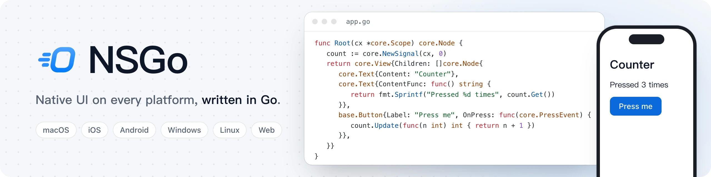

<h1 align="center">
  <picture>
    <source media="(prefers-color-scheme: dark)" srcset=".github/banner/en-dark.webp">
    
  </picture>
</h1>

<p align="center">
  <a href="README.md">English</a> |
  <a href="README.zh-CN.md">简体中文</a> |
  <a href="README.zh-TW.md">繁體中文</a> |
  <a href="README.ja.md">日本語</a> |
  <a href="README.ko.md">한국어</a> |
  <a href="README.es.md">Español</a> |
  <a href="README.fr.md">Français</a> |
  <a href="README.de.md">Deutsch</a> |
  <a href="README.pt.md">Português</a> |
  <a href="README.ru.md">Русский</a> |
  <strong>Italiano</strong> |
  <a href="README.vi.md">Tiếng Việt</a> |
  <a href="README.id.md">Bahasa Indonesia</a> |
  <a href="README.tr.md">Türkçe</a>
</p>

<p align="center">
  <a href="https://github.com/nsgo-dev/nsgo/releases/latest"></a>
  <a href="https://pkg.go.dev/github.com/nsgo-dev/nsgo"></a>
  <a href="LICENSE"></a>
</p>

<p align="center">
  <a href="https://github.com/oneo-me"></a>
  <a href="https://oneo.me"></a>
  <a href="https://x.com/oneo666"></a>
  <a href="https://t.me/nsgo_dev"></a>
  <a href="https://github.com/sponsors/oneo-me"></a>
</p>

<p align="center">
  Un motore UI nativo multipiattaforma con backend in Go: la logica dell'app, il grafo reattivo e il layout girano in Go, e ogni piattaforma disegna con la propria UI nativa.<br>
  Segue il design di <a href="https://nsh.dev">Native Shell (NSH)</a>, per i team che vogliono il modello di NSH senza scrivere Rust.
</p>

<p align="center">
  <picture>
    <source media="(prefers-color-scheme: dark)" srcset="website/src/assets/screens/desktop-en-dark.jpg">
    
  </picture>
  <picture>
    <source media="(prefers-color-scheme: dark)" srcset="website/src/assets/screens/phone-en-dark.jpg">
    
  </picture>
</p>

## Punti di forza

- **Viste native.** Testo, metodi di input, scorrimento, menu e accessibilità sono quelli di ciascuna piattaforma, e ciò che una piattaforma ha, come Liquid Glass, le altre lo imitano.
- **Ogni piattaforma da un solo Mac.** Go compila ogni target, con Xcode per iOS, tvOS e watchOS e un NDK solo per l'emulatore Android x86_64: niente Android SDK, JDK, GTK né toolchain Windows.
- **Aggiornamenti granulari.** I componenti girano una volta sola e i signal aggiornano solo ciò che li legge, con layout flexbox e grid, stili simili a CSS, classi Tailwind, temi e animazioni sul frame clock della piattaforma.
- **Componenti.** `base` offre componenti senza stile, dai pulsanti a una `DataTable` da un milione di righe, grafici, diagrammi di flusso, un editor di codice, un editor di testo formattato e un terminale, e `ui` dà loro l'aspetto di NSGo.
- **Servizi di piattaforma.** Navigazione, notifiche, permessi, selettori, condivisione, feedback aptico, acquisti in-app, widget e Live Activities, e sui desktop finestre, pannelli, menu, icone nella barra di sistema e scorciatoie globali.
- **Localizzazione.** Cataloghi di messaggi YAML con plurali, numeri e date CLDR, e layout da destra a sinistra.
- **App TSX.** Scrivi app in TSX come fa NSH, con aggiornamenti a caldo che mantengono lo stato, e distribuiscile come pacchetti firmati e in sandbox eseguiti da un'app Go.
- **Test che agiscono come gli utenti.** `nsgotest` preme, digita e legge ciò che è sullo schermo, headless o su ciascuna piattaforma con input nativo e screenshot.
- **Lo strumento `nsgo`.** Crea app, eseguile con hot reload e DevTools, e impacchettale per gli app store, Flathub e il download diretto con aggiornamenti.
- **Leggero e veloce.** Un'app contatore pesa circa 8 MB sui desktop e si avvia più velocemente di NSH, MyGo e GPUI nei benchmark di NSGo.

## Piattaforme

| Piattaforma | Disegna con | Stato |
| --- | --- | --- |
| macOS | AppKit e Core Text | Funziona |
| iOS e App Clips | UIKit e Core Text | Funziona nel simulatore e sui dispositivi; App Clips nel simulatore |
| tvOS | UIKit, guidato dal focus del telecomando | Funziona nel simulatore |
| watchOS | SwiftUI e Core Graphics | Funziona nel simulatore |
| Android | Android Views | Funziona su dispositivi arm64 ed emulatori x86_64 |
| Windows | Direct2D e DirectWrite | Funziona |
| Linux | GTK 4, Pango e Cairo | Funziona |
| Web | Elementi DOM, da WebAssembly | Funziona |
| HarmonyOS | ArkUI | Anteprima |
| Mini-programmi WeChat, QQ, Alipay e Douyin | Le viste di ciascuna piattaforma | Sperimentale, entro il loro limite di 2 MB |

Le app si incorporano anche in app iOS, Android, desktop Go e web già esistenti. [ARCHITECTURE.md](ARCHITECTURE.md#platforms) spiega come ogni target raggiunge il proprio sistema.

## Per iniziare

Con [Go](https://go.dev/dl/) 1.27.3 o successivo, e Xcode per iOS, tvOS e watchOS, installa `nsgo` ([altri modi](docs/public/en/getting-started.md#install-nsgo)), poi crea un'app ed eseguila con hot reload:

```sh
brew install nsgo-dev/tap/nsgo
nsgo init -module example.com/hello hello   # -template tsx per un'app TSX
cd hello
nsgo dev    # -target web, ios_simulator, tvos_simulator, watchos_simulator, android o miniprogram_wechat per eseguirla altrove
nsgo doctor # quali target questa macchina compila ed esegue, e cosa manca agli altri
```

Un'app è fatta di componenti Go che restituiscono elementi, con signal che aggiornano ciò che li legge:

```go
package main

import (
	"fmt"

	"github.com/nsgo-dev/nsgo"
	"github.com/nsgo-dev/nsgo/core"
	"github.com/nsgo-dev/nsgo/ui"
)

func Root(cx *core.Scope) core.Node {
	count := core.NewSignal(cx, 0)
	return core.View{Style: core.Style{Padding: core.All(24), Gap: 12}, Children: []core.Node{
		core.Text{ContentFunc: func() string { return fmt.Sprintf("Pressed %d times", count.Get()) }},
		ui.Button{Text: "Press me", OnPress: func() { count.Update(func(n int) int { return n + 1 }) }},
	}}
}

func main() { nsgo.Run(Root) }
```

I suoi test usano l'app come farebbe un utente, e `nsgo test` li esegue headless o, con `-target`, su una piattaforma:

```go
func TestPress(t *testing.T) {
	app := nsgotest.Start(t, Root)
	app.Press("role:button Press me")
	app.Find("text:Pressed 1 times")
}
```

Per provare ciò che è su `main` prima del rilascio, esegui `go get github.com/nsgo-dev/nsgo@main`.

## Stato

NSGo è agli inizi e la sua API non è ancora stabile. Le [release](https://github.com/nsgo-dev/nsgo/releases) elencano cosa è cambiato in ciascuna versione, e la [roadmap](docs/roadmap.md) cosa manca ancora.

## Documentazione

La [documentazione](https://nsgo.dev/it/docs/) tratta componenti e stato, layout, stili, navigazione, un riferimento dei componenti, app TSX, localizzazione, test, incorporamento, compilazione e distribuzione; la [demo dal vivo](https://nsgo.dev/gallery/) esegue la gallery nel browser.

Gli agenti di programmazione imparano NSGo dalla sua skill, `bunx skills add nsgo-dev/nsgo`, e leggono la documentazione in Markdown da [llms.txt](https://nsgo.dev/llms.txt).

## Sviluppo

```sh
go tool nsgo dev examples/gallery   # esegue la gallery
go tool nsgo check                  # controlla ogni pacchetto
go tool nsgo test                   # i test di ogni pacchetto
```

[Configurazione dell'ambiente di sviluppo](https://nsgo.dev/it/docs/contributing/) contiene il resto della configurazione. Leggi [ARCHITECTURE.md](ARCHITECTURE.md) e [AGENTS.md](AGENTS.md) prima di modificare il codice, e [CHANGELOG.md](CHANGELOG.md) per cosa è cambiato dall'ultima release.

## Community

Domande, idee e ciò che costruisci con NSGo sono benvenuti in nsgo-dev-community, il gruppo Telegram [@nsgo_dev](https://t.me/nsgo_dev). Segnala bug e proponi modifiche nelle [issue](https://github.com/nsgo-dev/nsgo/issues).

<p align="center">
  <a href="https://t.me/nsgo_dev"></a>
</p>

## Sponsor

[Depot](https://depot.dev) sponsorizza la CI di NSGo: i suoi runner compilano e testano NSGo su Linux, macOS e Windows.

<p align="center">
  <a href="https://depot.dev"><picture>
    <source media="(prefers-color-scheme: dark)" srcset="website/src/assets/sponsors/depot-dark.svg">
    
  </picture></a>
</p>

## Licenza

Distribuito sotto la [Apache License, Version 2.0](LICENSE). NSGo è un port di NSH, e [NOTICE](NOTICE) riporta l'attribuzione dovuta per questo port.

Salvo tua esplicita indicazione contraria, qualsiasi contributo che invii intenzionalmente per l'inclusione in NSGo, come definito nella licenza Apache-2.0, sarà concesso in licenza Apache-2.0, senza termini o condizioni aggiuntivi.
